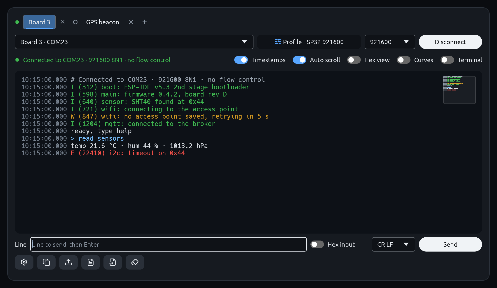
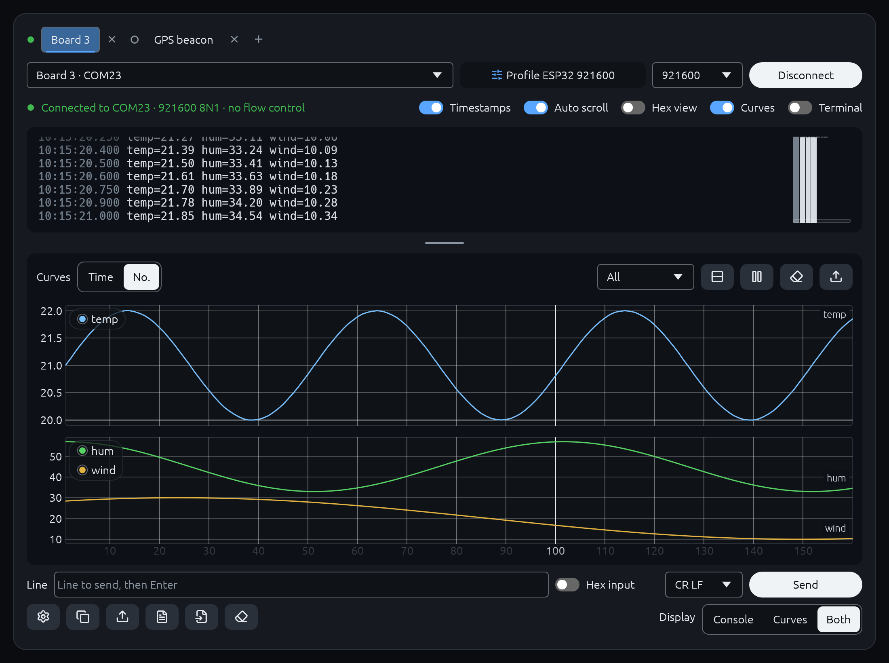
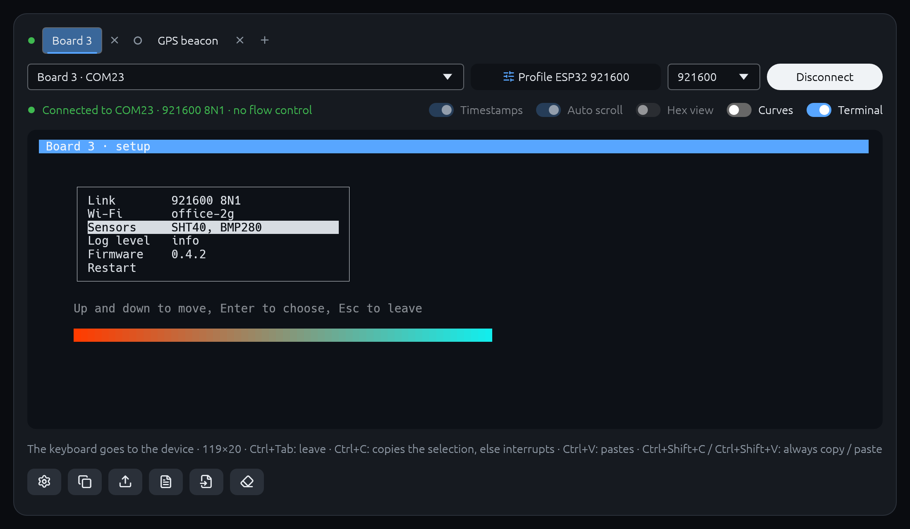
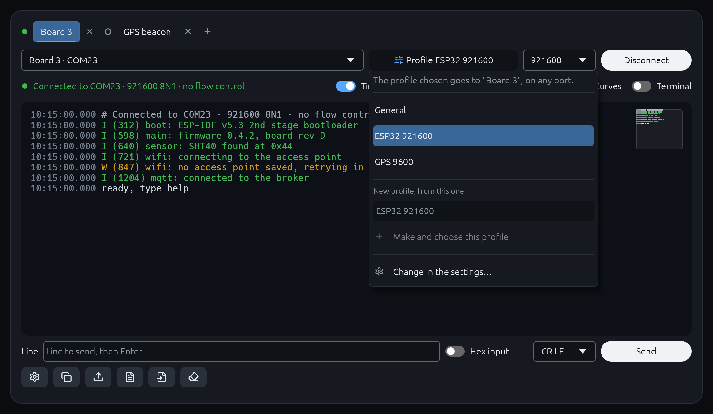
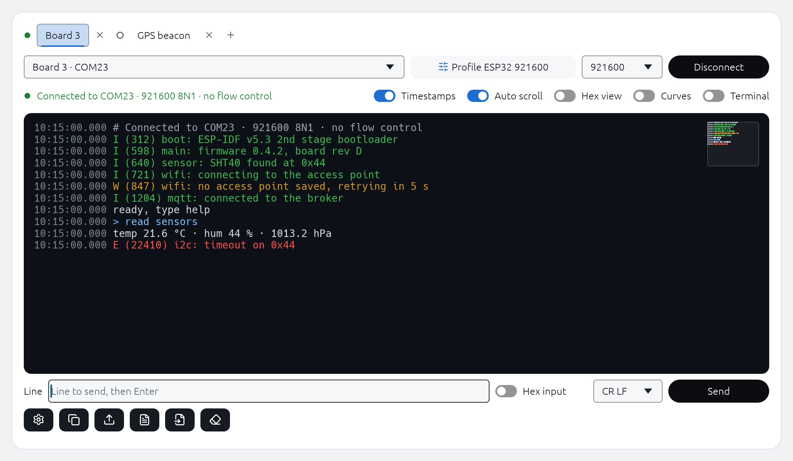

# RSC · Rust Serial Console

**The ultimate serial console for boards, sensors and modems.**

RSC is a desktop serial terminal for Windows, macOS and Linux. Pick a port, read what the device sends, send it lines or files, watch its measures as curves, or use it as a full terminal. Several ports at once, nothing to set up to begin.

## Download

Take the archive of your system from the [latest release](https://github.com/zetaSoftTeam/rsc/releases/latest):

| System | Archive | Then |
|---|---|---|
| Windows, x86-64 | `rsc-<version>-windows-x86_64.zip` | extract it and run `rsc.exe` |
| macOS, Apple silicon | `rsc-<version>-macos-arm64.zip` | extract it and move `RSC.app` to Applications |
| Linux, x86-64 | `rsc-<version>-linux-x86_64.tar.gz` | extract it and run `./install.sh`: RSC is in your menus |
| Linux, arm64 (Raspberry Pi OS 64-bit) | `rsc-<version>-linux-arm64.tar.gz` | the same |

RSC's executables are not signed with a paid certificate: the first time, Windows SmartScreen or [macOS](https://support.apple.com/guide/mac-help/mh40616/mac) may say their publisher is unknown. Each release publishes the SHA-256 of its archives (`SHA256SUMS.txt`) and an attestation that they were built here, from the tagged sources: `gh attestation verify <archive> --repo zetaSoftTeam/rsc`. For 0.1.0, built before the repository moved here: `--owner jferdelyi` in place of `--repo`.

Under Linux, serial ports belong to a group: `sudo usermod -aG dialout $USER` (`uucp` on Arch), then log out and in again.

## Build from source

With [Rust](https://rustup.rs) 1.100 or later:

| System | Command | Result |
|---|---|---|
| Windows | `.\build.ps1 -Install` | RSC installed for you, in the Start menu |
| macOS | `./build.sh` | `build/macos/RSC.app` |
| Linux | `./build.sh --install` | RSC installed for you, in your menus |

## Getting started

1. Plug the device in, pick it in the first list of the bar, set the baud rate, then **Connect**. What the device sends shows in the console.
2. Type a line at the bottom, then Enter; the up and down arrows bring back the lines already sent.
3. For other settings, click the **General profile** pill in the bar: make a profile from it, and give it to the device with **Name this device…**. RSC finds the device again on any port, with its profile.

## Features

- **Several ports at once**, one per tab; a USB device you name is found again on any port.
- **A console** in colour or in hexadecimal, with timestamps, copy, export and a journal written as it goes.
- **Curves** of the measures a device writes (`temp=21.5 hum=40`, the Arduino plotter's format), in one or two charts, exported as CSV.
- **A full terminal mode**: shells, vi, menus, 256 and direct colours, line drawing.
- **A library of profiles**, each with all its link and display values.
- **Keyboard and screen readers**: audited against WCAG 2.2 AA.
- **French or English**, light or dark.
- **No network connection**, and no `unsafe` code.

| Curves of the measures, in two charts | The terminal mode: a device's menu |
|---|---|
|  |  |
| **The profile pill: a profile per device** | **The light theme** |
|  |  |

## Documentation

- [User guide](docs/guide.md): the window, the terminal mode, profiles and settings, the settings file, security.
- [Development](docs/development.md): building, tests, measures, releases, the files, dependencies and licences.

## Platforms

| Platform | State |
|---|---|
| Windows 11, x86-64 | tested: test suite, the real window, real devices |
| Linux x86-64 | tested: test suite, the real window |
| macOS, Apple silicon | test suite; `RSC.app` built and started |
| Linux arm64 | built, never run |

## Licence

RSC © 2026 Jean-François Erdelyi, under the [Eclipse Public License 2.0](LICENSE). The licences of the components it is made of are in RSC itself (Settings, About) and in each archive.
